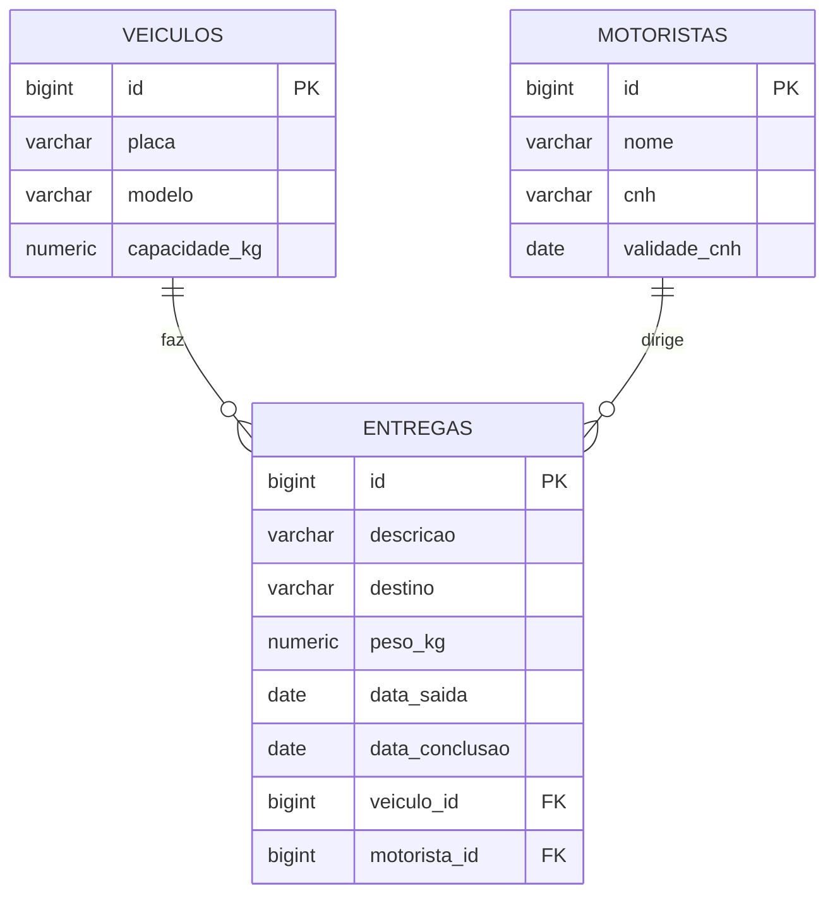

# Modelo de domínio

O sistema tem três entidades: Veiculo, Motorista e Entrega. Cada entrega pertence a um veículo e a um motorista.

## Entidades

### Veiculo

Veículo da frota. A capacidade é usada na regra R1.

| Atributo | Tipo C# | Coluna | Obrigatório | Observação |
| `Id` | `long` | `id` | sim | Gerado pelo banco |
| `Placa` | `string` | `placa` | sim | Até 10 caracteres |
| `Modelo` | `string` | `modelo` | sim | Até 100 caracteres |
| `CapacidadeKg` | `decimal` | `capacidade_kg` | sim | Maior que zero |

### Motorista

Motorista da transportadora. A validade da CNH é usada na regra R2.

| Atributo | Tipo C# | Coluna | Obrigatório | Observação |
| `Id` | `long` | `id` | sim | Gerado pelo banco |
| `Nome` | `string` | `nome` | sim | Até 150 caracteres |
| `Cnh` | `string` | `cnh` | sim | Até 20 caracteres |
| `ValidadeCnh` | `DateOnly` | `validade_cnh` | sim | Formato `yyyy-MM-dd` |

### Entrega

Carga levada por um veículo e um motorista até o destino.

| Atributo | Tipo C# | Coluna | Obrigatório | Observação |
| `Id` | `long` | `id` | sim | Gerado pelo banco |
| `Descricao` | `string` | `descricao` | sim | Até 255 caracteres |
| `Destino` | `string` | `destino` | sim | Até 255 caracteres |
| `PesoKg` | `decimal` | `peso_kg` | sim | Maior que zero e não pode passar da capacidade do veículo (R1) |
| `DataSaida` | `DateOnly` | `data_saida` | sim | A API preenche com o dia do cadastro |
| `DataConclusao` | `DateOnly?` | `data_conclusao` | não | Fica vazia até a entrega ser concluída (R3) |
| `VeiculoId` | `long` | `veiculo_id` | sim | Chave estrangeira para `veiculos` |
| `MotoristaId` | `long` | `motorista_id` | sim | Chave estrangeira para `motoristas` |

## Relacionamentos

| De | Para | Tipo | No banco | No código |
| Entrega | Veiculo | muitos para um | `entregas.veiculo_id` referencia `veiculos(id)` | `VeiculoId` e `Veiculo` em `Entrega` |
| Entrega | Motorista | muitos para um | `entregas.motorista_id` referencia `motoristas(id)` | `MotoristaId` e `Motorista` em `Entrega` |

Um veículo ou motorista que já tem entrega não pode ser apagado (`ON DELETE RESTRICT`).

## Diagrama ER

## Migrations

Ficam em `Migrations/`, uma por tabela, e rodam em ordem quando a API sobe.

| Ordem | Arquivo | O que cria |
| 1 | `20261010214223_CriarVeiculos.cs` | Tabela `veiculos` |
| 2 | `20261010214236_CriarMotoristas.cs` | Tabela `motoristas` |
| 3 | `20261010214245_CriarEntregas.cs` | Tabela `entregas`, com as duas chaves estrangeiras |
